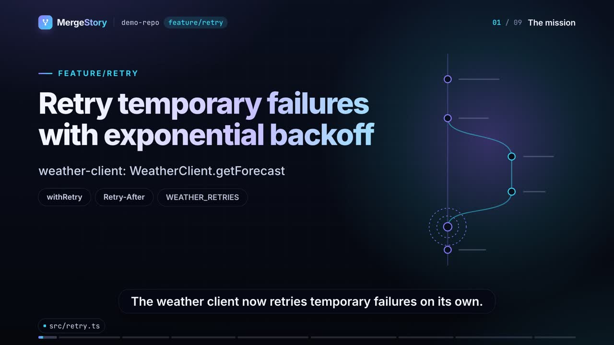
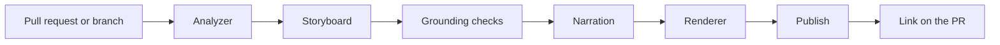

<div align="center">

# MergeStory

[](https://github.com/PiniShv/MergeStory/actions/workflows/ci.yml)
[](https://www.npmjs.com/package/mergestory)
[](LICENSE)

**Every change has a story.**

MergeStory turns a pull request into a short, narrated video that explains what changed, why,
and what to review: animated architecture diagrams, the real code, captions and a review checklist.

</div>

> **Not sure what changed? Watch the 2-minute MergeStory.**

Reviewing a large diff means rebuilding the author's thinking in your head. MergeStory does that
part for you. When a coding agent (or a person) opens a pull request, MergeStory analyses the
change, writes a grounded storyboard, narrates it, renders an MP4, and returns a link to post on
the pull request.

- **Accurate by design.** Every narration line cites evidence from the change. Code on screen is
  read from the repository, never generated. Claims nobody can check ("all tests pass") are
  removed unless real test results were supplied.
- **Very cheap.** By default no paid service is called at all: the coding agent writes the
  storyboard, speech and rendering run locally. Paid models are opt-in and capped by a budget.
- **Private by default.** Nothing from your code or the change leaves your machine unless you
  configure it. Secrets are masked in every frame, caption and log. Shared links are private and
  expire.
- **Works with any agent.** A portable [Agent Skill](plugins/mergestory/skills/mergestory/SKILL.md) for Claude Code,
  Codex, Copilot, Cursor and others, plus a CLI, an HTTP API and a library.

## See it in action

<!-- demo-video -->
[](https://pinishv.github.io/MergeStory/demo/)

The video explains a change that adds retries with exponential backoff to a small weather API client.
Open it on MergeStory's own [watch page](https://pinishv.github.io/MergeStory/demo/), with chapters,
captions and the review checklist.

## What a video looks like

A typical video is 45 seconds to 3 minutes, depending on the size of the change:

1. **The mission:** the task and the problem it solves.
2. **The big picture:** which components changed and how they connect.
3. **Under the hood:** the most important code, highlighted line by line.
4. **Before and after:** how behaviour changes (when there is something real to show).
5. **What to review:** risky or subtle spots, with file and line links.
6. **Conclusion:** a short, review-oriented summary.

Next to the video, a watch page lists the chapters, the review checklist and every claim with links
to the code it is based on. Simulated visuals (terminal sessions, app screens) are always labelled.

## Quick start

Requirements: Node.js 22.12+, git, [FFmpeg](https://ffmpeg.org/download.html), and Google Chrome or
another Chromium browser (or `npx playwright install chromium-headless-shell`).

```bash
npm install -g mergestory
```

```bash
mergestory doctor
```

Explain a pull request (the video stays on your machine):

```bash
mergestory generate https://github.com/acme/weather-app/pull/42
```

The first English video installs the free voice once (about 400 MB, then the voice model), so it
takes a minute or two longer. Nothing from the change is sent. To do it ahead of time, for example in CI,
run `mergestory setup kokoro`.

Or a local branch, without a pull request. This works with every git host:

```bash
mergestory generate . --base main --head feature/retry
```

Try it on the included demo project ([how it works](examples/demo/README.md)):

```bash
./examples/demo/create-demo-repo.sh /tmp/mergestory-demo
```

```bash
mergestory generate /tmp/mergestory-demo --base main --head feature/retry
```

The result points to `video.mp4` and a local watch page. Add `--dry-run` to see the plan, the cost
estimate and what would leave the machine, without rendering anything.

## Use it from a coding agent

Install the skill, then ask the agent to "explain this PR as a video" or to run MergeStory after it
opens a pull request.

| Agent | Install |
|---|---|
| Many agents at once | `npx skills add PiniShv/MergeStory` (needs Node.js 22.20 or newer) |
| Claude Code | `/plugin install mergestory --marketplace PiniShv/MergeStory` (Claude Code 2.1.275 or newer). On older versions: `/plugin marketplace add PiniShv/MergeStory`, then `/plugin install mergestory@mergestory`. |
| Claude Code, by hand | copy `plugins/mergestory/skills/mergestory` to `~/.claude/skills/mergestory` (all projects) or `<project>/.claude/skills/mergestory` (one project). Claude Code does not read `.agents/skills`. |
| Codex, GitHub Copilot (VS Code, CLI and cloud agent), Cursor, OpenCode, Goose, Amp, Gemini CLI, Antigravity | copy `plugins/mergestory/skills/mergestory` to `.agents/skills/mergestory` (one project) or `~/.agents/skills/mergestory` (all projects). Copilot also reads `.github/skills`, and Cursor also reads `.cursor/skills`. |
| GitHub CLI | `gh skill install PiniShv/MergeStory mergestory` (GitHub CLI 2.90 or newer) |
| Windsurf (now Devin Desktop) | copy to `.devin/skills/mergestory`. It also reads `.agents/skills`. |
| Kiro | copy to `.kiro/skills/mergestory` |
| Cline | copy to `.cline/skills/mergestory` or `.claude/skills/mergestory` |

Gemini CLI is now for Code Assist. Other people use Google's Antigravity CLI (`agy`). Both read
`.agents/skills`.

With the skill, the agent writes the storyboard itself from MergeStory's evidence pack. The agent
knows why it made each decision, so the story is better, and no extra model is paid for. The engine
still checks every claim and every line reference before rendering. See [the storyboard
format](docs/storyboard.md).

## Share the video

By default a video stays on your machine. Look at it first, and share it when you are happy:

```bash
mergestory publish <run-id> --publish s3 --comment
```

You can also upload while you generate: `mergestory generate <pull request> --publish s3 --comment`.

- **S3-compatible storage** (Cloudflare R2, Amazon S3, Backblaze B2, Google Cloud Storage, or your own
  server): private links that expire in 7 days at most, permanent links behind your team's sign-in
  (`--visibility protected`), or public links for public code.
- **YouTube:** `--publish youtube` uploads to your own channel. The video is unlisted unless you choose
  otherwise.
- **The pull request:** `--comment` posts one comment with the link, and `--update-description` adds a
  short section to the description. Both need a video that is not only on your machine.

Public links for a private repository are blocked unless you allow them. Set-up guides:
[hosting your videos](docs/hosting.md) and [publishing to YouTube](docs/youtube.md).

## Use it in CI

Run the CLI in GitHub Actions on labelled pull requests and post the link as a comment. Copy
[`examples/github-actions/mergestory.yml`](examples/github-actions/mergestory.yml) and read
[docs/github-actions.md](docs/github-actions.md).

## Configuration

Everything works with no configuration. A flag beats an environment variable, and an environment
variable beats the config file. Common options:

| What | Flag | Environment variable |
|---|---|---|
| Storyboard by an LLM | `--llm anthropic` (or `openai`, `openai-compatible`) | `MERGESTORY_LLM_PROVIDER`, plus `ANTHROPIC_API_KEY` / `OPENAI_API_KEY` |
| Voice | `--tts kokoro` (local), `say` (macOS), `openai`, `elevenlabs`, `none` | `MERGESTORY_TTS_PROVIDER` |
| Upload | `--publish s3` (or `youtube`) | `MERGESTORY_PUBLISH_PROVIDER`, `MERGESTORY_S3_BUCKET`, `MERGESTORY_S3_ENDPOINT`, credentials |
| Comment on the PR | `--comment` (needs an uploaded video) | `GITHUB_TOKEN` (or the `gh` CLI login) |
| Budget per run | `--budget 0.25` | `MERGESTORY_BUDGET_USD` |
| Quality | `--quality draft`, `standard`, `high` | `MERGESTORY_QUALITY` |
| Config file | none | `MERGESTORY_CONFIG` (default: `~/.mergestory/config.json`) |

Free local voice: English videos use Kokoro, an open neural voice that runs on your machine. The
first English video installs it once (about 400 MB plus a one-time model download), and
`mergestory setup kokoro` does it ahead of time. `--tts say` (macOS) or `--tts none` skips it.

Full reference: [docs/configuration.md](docs/configuration.md) and [docs/cli.md](docs/cli.md).

## What it costs

| Step | Default | Typical cost per video |
|---|---|---|
| Storyboard | written by your coding agent, or built offline | $0 |
| Storyboard with Claude Haiku 5.5 (opt-in) | `--llm anthropic` | under $0.01 |
| Voice | local | $0 |
| Rendering | local | $0 |
| Hosting on Cloudflare R2 or S3 | opt-in | a fraction of a cent per month |

Every run prints its real cost, and stops before any call that would go over the budget.

## Privacy and security

MergeStory reads code that may be private, so the defaults are strict: no telemetry, no uploads
unless configured, a one-time download of the free voice that sends nothing from the change, sensitive files (`.env`, keys, credentials) never shown or sent, secrets masked
everywhere, private links that expire (or permanent links behind your team's sign-in), and read-only
access to your repository. Details: [SECURITY.md](SECURITY.md).

## How it works



The engine (`packages/engine`) is the product. The Agent Skill (`plugins/mergestory/skills/mergestory`) is a thin
adapter, packaged as a Claude Code plugin in `plugins/mergestory`. Videos are rendered programmatically from a JSON plan by a deterministic HTML runtime and
FFmpeg, so the same input gives the same video. Read [docs/architecture.md](docs/architecture.md).

## Documentation

- [Architecture](docs/architecture.md)
- [CLI reference](docs/cli.md)
- [Configuration](docs/configuration.md)
- [Storyboard format](docs/storyboard.md)
- [GitHub Actions](docs/github-actions.md)
- [HTTP API and library](docs/api.md)
- [Hosting your videos](docs/hosting.md)
- [Publishing to YouTube](docs/youtube.md)
- [The demo](examples/demo/README.md)
- [Security](SECURITY.md)
- [Contributing](CONTRIBUTING.md)
- [Code of Conduct](CODE_OF_CONDUCT.md)
- [Changelog](CHANGELOG.md)

## License

[Apache-2.0](LICENSE). Bundled fonts: Inter and JetBrains Mono (SIL Open Font License 1.1).
