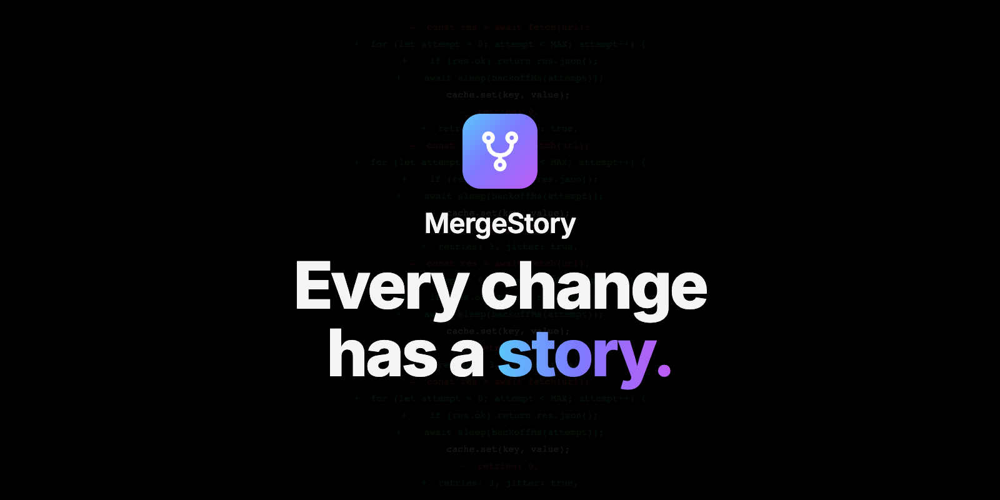
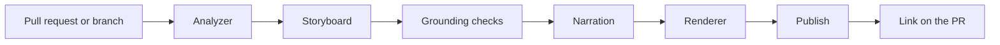

<div align="center">



[](https://github.com/PiniShv/MergeStory/actions/workflows/ci.yml)
[](https://www.npmjs.com/package/mergestory)
[](LICENSE)

# Your pull request. Explained.

[Website](https://mergestory.pinishv.com) · [Watch the film](https://www.youtube.com/watch?v=Ylp5W4oaAqM) · [Watch the demo](https://www.youtube.com/watch?v=yZaKPyuZN1Q) · [Get started](#get-started)

<sub>"Free" in the film means MergeStory adds no charge with the default settings. [What can still cost money](docs/cost.md#what-can-still-cost-money).</sub>

</div>

<br>

MergeStory turns a pull request into a short narrated video. It shows what changed, why, and what to review.

A typical video runs from 45 seconds to 3 minutes. It has animated architecture diagrams, the real code highlighted line by line, captions and a review checklist.

## Reads. Tells. Checks.

MergeStory **reads** the change. Your coding agent **tells** the story. The engine **checks** every claim before it renders a single frame.

Then you get an MP4, captions (VTT and SRT), a poster image and a local watch page.

## Every line cites the code.

Every narration line cites evidence from the change. Code on screen is read from the repository, never generated.

Claims nobody can check, like "all tests pass", are removed unless real test results were supplied.

## $0. By design.

By default, MergeStory itself calls no paid service.[^cost] [See what it costs and why.](#what-it-costs)

## Private by default.

No telemetry. Nothing from your code leaves your machine unless you set it up. Secrets and e-mail addresses are masked in every frame, caption and log.

## Works with your agent.

An Agent Skill for Claude Code, Codex, GitHub Copilot, Cursor, OpenCode, Goose, Amp, Gemini CLI, Windsurf, Kiro and Cline. Also a CLI, an HTTP API, a library and a GitHub Actions example.

---

## See it in action

<!-- demo-video -->
[](https://mergestory.pinishv.com/demo/)

The video explains a change that adds retries with exponential backoff to a small weather API client.
[Watch it on YouTube](https://www.youtube.com/watch?v=yZaKPyuZN1Q), or open the
[watch page](https://mergestory.pinishv.com/demo/) with the chapters and the review checklist.

## What a video looks like

1. **The mission:** the task and the problem it solves.
2. **The big picture:** which components changed and how they connect.
3. **Under the hood:** the most important code, highlighted line by line.
4. **Before and after:** how behaviour changes (only when there is something real to show).
5. **What to review:** risky or subtle spots, with file and line links.
6. **Conclusion:** a short, review-oriented summary.

Next to the video, a watch page lists the chapters, the review checklist and every claim with links
to the code it is based on. Simulated visuals (terminal sessions, app screens) are always labelled.

## Get started

Requirements: Node.js 22.12+, git, [FFmpeg](https://ffmpeg.org/download.html), and Google Chrome or
another Chromium browser (or `npx playwright install chromium-headless-shell`).

```bash
npm install -g mergestory
```

```bash
mergestory doctor
```

Explain a pull request (the video stays on your machine):

```bash
mergestory generate https://github.com/acme/weather-app/pull/42
```

The first English video installs the free voice once (about 400 MB, then the voice model), so it
takes a minute or two longer. Nothing from the change is sent. To do it ahead of time, for example in CI,
run `mergestory setup kokoro`.

Or a local branch, without a pull request. This works with every git host:

```bash
mergestory generate . --base main --head feature/retry
```

Try it on the included demo project ([how it works](examples/demo/README.md)):

```bash
./examples/demo/create-demo-repo.sh /tmp/mergestory-demo
```

```bash
mergestory generate /tmp/mergestory-demo --base main --head feature/retry
```

The result points to `video.mp4` and a local watch page. Add `--dry-run` to see the plan, the cost
estimate and what would leave the machine, without rendering anything.

## Use it from a coding agent

Install the skill, then ask the agent to "explain this PR as a video". After it opens a pull request,
the agent offers a video and makes one only when you say yes.

| Agent | Install |
|---|---|
| Many agents at once | `npx skills add PiniShv/MergeStory` (needs Node.js 22.20 or newer) |
| Claude Code | `/plugin install mergestory --marketplace PiniShv/MergeStory` (Claude Code 2.1.275 or newer). On older versions: `/plugin marketplace add PiniShv/MergeStory`, then `/plugin install mergestory@mergestory`. |
| Claude Code, by hand | copy `plugins/mergestory/skills/mergestory` to `~/.claude/skills/mergestory` (all projects) or `<project>/.claude/skills/mergestory` (one project). Claude Code does not read `.agents/skills`. |
| Codex, GitHub Copilot (VS Code, CLI and cloud agent), Cursor, OpenCode, Goose, Amp, Gemini CLI, Antigravity | copy `plugins/mergestory/skills/mergestory` to `.agents/skills/mergestory` (one project) or `~/.agents/skills/mergestory` (all projects). Copilot also reads `.github/skills`, and Cursor also reads `.cursor/skills`. |
| GitHub CLI | `gh skill install PiniShv/MergeStory mergestory` (GitHub CLI 2.90 or newer) |
| Windsurf (now Devin Desktop) | copy to `.devin/skills/mergestory`. It also reads `.agents/skills`. |
| Kiro | copy to `.kiro/skills/mergestory` |
| Cline | copy to `.cline/skills/mergestory` or `.claude/skills/mergestory` |

Gemini CLI is now for Code Assist. Other people use Google's Antigravity CLI (`agy`). Both read
`.agents/skills`.

With the skill, the agent writes the storyboard itself from MergeStory's evidence pack. The agent
knows why it made each decision, so the story is better, and MergeStory calls no extra paid model.
Reading the evidence pack and writing the storyboard is extra usage in your agent's session. The engine
still checks every claim and every line reference before rendering. See [the storyboard
format](docs/storyboard.md). The skill itself is in
[plugins/mergestory/skills/mergestory/SKILL.md](plugins/mergestory/skills/mergestory/SKILL.md).

## Share the video

By default a video stays on your machine. Look at it first, and share it when you are happy:

```bash
mergestory publish <run-id> --publish s3 --comment
```

You can also upload while you generate: `mergestory generate <pull request> --publish s3 --comment`.

- **S3-compatible storage** (Cloudflare R2, Amazon S3, Backblaze B2, Google Cloud Storage, or your own
  server): private links that expire in 7 days at most, permanent links behind your team's sign-in
  (`--visibility protected`), or public links for public code.
- **YouTube:** `--publish youtube` uploads to your own channel. The video is unlisted unless you choose
  otherwise.
- **Google Drive:** `--publish drive` uploads to a `MergeStory` folder in your own Drive. The link is
  private by default; `--visibility protected` opens it to your Google Workspace organization.
- **The pull request:** `--comment` posts one comment with the link, and `--update-description` adds a
  short section to the description. Both need a video that is not only on your machine.

Public links for a private repository are blocked unless you allow them. Set-up guides:
[hosting your videos](docs/hosting.md), [publishing to YouTube](docs/youtube.md) and
[publishing to Google Drive](docs/drive.md).

## Use it in CI

Run the CLI in GitHub Actions on labelled pull requests and post the link as a comment. Copy
[`examples/github-actions/mergestory.yml`](examples/github-actions/mergestory.yml) and read
[docs/github-actions.md](docs/github-actions.md).

## Configuration

Everything works with no configuration. A flag beats an environment variable, and an environment
variable beats the config file. Common options:

| What | Flag | Environment variable |
|---|---|---|
| Storyboard by an LLM | `--llm anthropic` (or `openai`, `openai-compatible`) | `MERGESTORY_LLM_PROVIDER`, plus `ANTHROPIC_API_KEY` / `OPENAI_API_KEY` |
| Voice | `--tts kokoro` (local), `say` (macOS), `openai`, `elevenlabs`, `none` | `MERGESTORY_TTS_PROVIDER` |
| Upload | `--publish s3` (or `youtube`, `drive`) | `MERGESTORY_PUBLISH_PROVIDER`, `MERGESTORY_S3_BUCKET`, `MERGESTORY_S3_ENDPOINT`, credentials |
| Comment on the PR | `--comment` (needs an uploaded video) | `GITHUB_TOKEN` (or the `gh` CLI login) |
| Budget per run | `--budget 0.25` | `MERGESTORY_BUDGET_USD` |
| Quality | `--quality draft`, `standard`, `high` | `MERGESTORY_QUALITY` |
| Config file | none | `MERGESTORY_CONFIG` (default: `~/.mergestory/config.json`) |

Local voice: English videos use Kokoro, an open neural voice that runs on your machine. The
first English video installs it once (about 400 MB plus a one-time model download), and
`mergestory setup kokoro` does it ahead of time. `--tts say` (macOS) or `--tts none` skips it.

Full reference: [docs/configuration.md](docs/configuration.md) and [docs/cli.md](docs/cli.md).

## What it costs

A default run calls no paid service, so MergeStory adds **$0** per video.[^cost] Other costs can still apply.

| Step | Default | Cost |
|---|---|---|
| Storyboard (the script) | Written by the coding agent you already use, from MergeStory's evidence pack. Without an agent, built offline from the analysis. | No MergeStory charge. Your agent reads the evidence pack and writes the script: extra usage, billed by its provider if you pay per token. |
| Voice | Kokoro, an open neural voice for English that runs on your own CPU. Installed once (about 400 MB plus the model download). | No fee. Uses your machine and disk. |
| Rendering | Your own browser draws each frame from a JSON plan. FFmpeg encodes. Same input, same video. | No fee. Uses your machine, or your CI minutes in CI. |
| Checks | Every claim and line reference is checked locally. | $0 |
| Sharing | Local by default. YouTube or Google Drive on your own account, or object storage. | Local: nothing. YouTube: no storage fee. Drive: your storage quota. R2 and S3: billed by the provider for storage and requests, and S3 also for data transfer out. |

### Why it is so cheap

- The agent already understands the change, so it writes the story. No second model reads the change again.
- The voice is open and runs on your CPU.
- Your own browser and FFmpeg render the video. No render farm, no cloud GPU.
- The checks run on your machine.
- A budget check runs before each paid MergeStory call, using estimated prices. It is a safeguard, not a
  guarantee. Every run prints its estimated cost.

Paid services are opt-in, and their providers bill your own account. A storyboard by Claude Haiku 5.5
(`--llm anthropic`) is estimated at under $0.01 per video, from list prices checked 2026-11. Providers change
prices, and your provider's bill is the final word. The default budget is $0.25 per run, checked before every
paid call. To cap your real bill, set a spending limit or alert with each provider.

Read [the full cost breakdown](docs/cost.md).

▶ [Watch the 70-second film on what it costs.](https://www.youtube.com/watch?v=6X5-zCe8PbU) It shows the
default settings. See [what can still cost money](docs/cost.md#what-can-still-cost-money).

## Privacy and security

MergeStory reads code that may be private, so the defaults are strict: no telemetry, no uploads
unless configured, a one-time download of the free voice that sends nothing from the change, sensitive files (`.env`, keys, credentials) never shown or sent, secrets masked
everywhere, private links that expire (or permanent links behind your team's sign-in), and read-only
access to your repository. Details: [SECURITY.md](SECURITY.md).

## How it works



The engine (`packages/engine`) is the product. The Agent Skill (`plugins/mergestory/skills/mergestory`) is a thin
adapter, packaged as a Claude Code plugin in `plugins/mergestory`. Videos are rendered programmatically from a JSON plan by a deterministic HTML runtime and
FFmpeg, so the same input gives the same video. Read [docs/architecture.md](docs/architecture.md).

## Documentation

- [Architecture](docs/architecture.md)
- [CLI reference](docs/cli.md)
- [Configuration](docs/configuration.md)
- [What it costs](docs/cost.md)
- [Storyboard format](docs/storyboard.md)
- [GitHub Actions](docs/github-actions.md)
- [HTTP API and library](docs/api.md)
- [Hosting your videos](docs/hosting.md)
- [Publishing to YouTube](docs/youtube.md)
- [Publishing to Google Drive](docs/drive.md)
- [The demo](examples/demo/README.md)
- [Security](SECURITY.md)
- [Contributing](CONTRIBUTING.md)
- [Code of Conduct](CODE_OF_CONDUCT.md)
- [Changelog](CHANGELOG.md)

## License

[Apache-2.0](LICENSE). The software is provided "as is", without warranties, and the license limits liability
(sections 7 and 8). Bundled fonts: Inter and JetBrains Mono (SIL Open Font License 1.1).

[^cost]: MergeStory is open source, and a default run calls no paid service, so MergeStory itself adds no charge. Your coding agent's usage, any model or voice you turn on, storage and CI minutes can still cost money, and their providers bill you. See [what can still cost money](docs/cost.md#what-can-still-cost-money).
