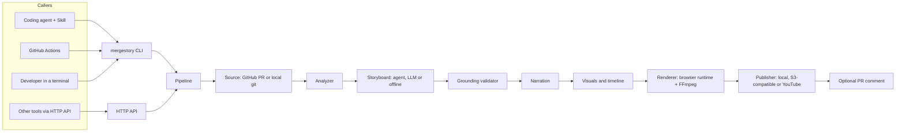

# Architecture

MergeStory has two parts with a hard boundary between them:

| Part | Where | Role |
|---|---|---|
| **Engine** | `packages/engine` (npm package `mergestory`) | The product. Analysis, storyboard, grounding, narration, visuals, rendering, publishing, GitHub integration. Exposed as a CLI, an HTTP API and a library. |
| **Agent Skill** | `plugins/mergestory/skills/mergestory` | An adapter for coding agents. It gathers context the agent knows, calls the engine CLI, and reports the result. It holds no video logic. |

The engine works without the skill. GitHub Actions, other tools and people call the same CLI or API.



## Design principles

1. **Accuracy first.** Every narration line cites evidence. Code on screen is read from the
   repository at render time; a storyboard can only point at line ranges. Claims that cannot be
   checked (performance numbers, "bug-free") are removed. "The tests pass" stays only when the caller
   reported a passing test run.
2. **Cheap by default.** The default run makes no paid calls: the storyboard comes from the coding
   agent or the offline generator, speech is local, rendering is local. Paid providers are
   opt-in, use the cheapest capable model, and are checked against an estimated budget before each call
   (default $0.25 per run).
3. **Private by default.** Nothing from the code or the change leaves the machine unless a provider
   is configured. Secrets are masked in code, captions, narration and logs. Shared links are private
   and expire by default.
4. **Programmatic, reproducible rendering.** Videos are rendered from a JSON plan by a
   deterministic HTML runtime. The same plan gives the same frames. No video-generation APIs.
5. **Read-only.** The engine never changes the repository or its git state, and writes to a pull
   request only when asked.
6. **Pluggable.** Sources, LLMs, speech, rendering and hosting sit behind small interfaces in
   `src/core/providers.ts`.

## Pipeline

`src/pipeline` runs these stages. Each writes its output to the run folder
(`$MERGESTORY_HOME/runs/<run-id>/`, which is `~/.mergestory/runs/<run-id>/` by default, or the
folder of `--out`), so every step can be inspected. The files are listed in
[cli.md](cli.md#run-folders).

| Stage | Module | Input | Output (run folder) |
|---|---|---|---|
| Source | `src/sources`, `src/github` | PR URL, or repo path + refs | `ChangeSet` + read-only `RepoReader` |
| Analyze | `src/analyzer` | ChangeSet, file contents, caller context | `analysis.json` (roles, components, symbols, risks, evidence index) |
| Storyboard | `src/storyboard`, `src/llm` | Evidence pack | `storyboard.json` |
| Validate | `src/storyboard/validate.ts` | Any storyboard | fixed storyboard + `grounding.json` |
| Narrate | `src/narration` | Storyboard | `narration/*.wav`, `audio.wav`, `captions.vtt`, `captions.srt` |
| Visuals | `src/visuals` | Storyboard + timing + repo | `render-plan.json` (real code, tokens, layout, timings) |
| Render | `src/render`, `src/runtime` | RenderPlan + audio | `video.mp4`, `poster.jpg` |
| Publish | `src/publish` | Video bundle | `watch/index.html` always; `publish/` for the local publisher; uploads for S3 and YouTube |
| Notify | `src/github` | Published links | One PR comment or description section (opt-in) |

`--dry-run` stops after validation and reports the storyboard outline, the estimated cost and
every outbound transfer the real run would make.

**Render first, share later.** When the video is rendered, the run folder also gets
`publish-input.json` (what publishing needs) and `result.json` (the result). `mergestory publish <run>`
starts at the Publish stage from those files, with no rendering and no paid call, so a person or an
agent can watch the local video before anything leaves the machine. If an upload fails, the rendered run
is kept and the error says which command uploads it again.

### How the pipeline is split

`src/pipeline` has one file for each job, and `run.ts` only connects them:

- `prepare.ts`: read the change, check the context, analyse (the first half of every run);
- `storyboard-choice.ts`: use the caller's storyboard, ask the model, or build the offline one, then
  validate it. `fit-duration.ts` trims it to `--max-duration` before any speech is made;
- `plan.ts` and `planned-egress.ts`: the dry-run plan (outline, cost, every outbound transfer);
- `presentation.ts`: the data for the watch page and the PR comment;
- `inputs.ts`: the one contract for caller context (task, notes, test results, screenshots);
- `authoring.ts`: `prepareAuthoring` and `checkStoryboard` for callers that write the storyboard;
- `publish-run.ts`: `publishRun`, which publishes a rendered run again.

## Data model

All shared types live in `src/core`:

- `types.ts`: `ChangeSet`, `Analysis`, `EvidenceItem`, narration, timeline, cost, egress, results.
- `storyboard-schema.ts`: the storyboard (Zod schema, also exported as JSON Schema).
- `render-plan.ts`: the fully resolved plan the browser runtime turns into frames.
- `providers.ts`: interfaces for sources, LLMs, speech, renderers and publishers.

Small modules with no dependency on the rest of the engine (leaf modules) hold the rules that
several stages share, so each rule is written once:

- `json.ts`, `text.ts` (`plural`, `shellQuote`, `truncate`, line ranges, the one invisible-character
  set), `posix.ts`, `ids.ts`: plain helpers;
- `net.ts`: `isLoopbackAddress` is the server's rule for what may skip the token; `isLoopbackHost`
  decides what counts as local for egress records and warnings;
- `concurrency.ts`: `Semaphore` and `mapLimit`;
- `errors.ts`: the typed errors, exit codes, `abortedError` and `assertNotAborted`;
- `child-env.ts` and `binary-paths.ts`: the clean environment and the known tool paths for child
  processes;
- `languages.ts`: the language registry (Shiki language id by path, `isCode`) that the sources
  use to set `ChangedFile.language`; later stages read that field;
- `secrets.ts`: secret detection. `maskPrivate(text, { maskEmails })` is the one way to mask secrets
  and then e-mail addresses;
- `run-folder.ts`: the fixed file names of a run folder (`RUN_FILE`), `runFolder()` and the checked
  read and write of `publish-input.json` and `result.json`;
- `storyboard-facts.ts`: facts that the validator, the duration fit, the visuals and the cost estimate
  must agree on (simulated visuals, beat holders, backing evidence, speech seconds);
- `diff-view.ts`: how a diff is read at one side and which rows a range shows, used by both the
  checks and the renderer;
- `diagram-metrics.ts`: the sizes that the diagram layout (Node) and the diagram template (browser)
  share.

### One privacy verdict

`path-policy.ts` is the only place that matches privacy patterns. It holds the one glob engine and
`createPathPolicy`, which combines the built-in sensitive files with `privacy.excludePaths`. The
sources use it once to set `ChangedFile.sensitive` (for the path and the old path). Every later
stage asks `isProtectedFile` or `isShowable` and never matches a pattern itself.

### Evidence ids

The analyzer gives every citable fact an id: `PR`, `TASK`, `NOTES`, `T1` (test result supplied by
the caller), `IS1` (linked issue), `CM1` (commit), `F2` (file), `F2.H1` (diff hunk), `S3` (symbol),
`M1` (component), `R1` (review risk), `D1` (dependency change), `SS1` (screenshot), `REPO`.
Storyboards cite these ids. The watch page lists every claim with links to the cited code.

### Storyboard

A storyboard has a title, a two-sentence summary, scenes, a review checklist and a list of
uncertainties. Each scene has a role (mission, big picture, under the hood, before/after, review,
conclusion), narration lines with evidence ids, one visual, a transition and an optional target
length. There are 13 visual types: `title`, `mission`, `files`, `architecture`, `flow`, `code`,
`before-after`, `terminal`, `browser`, `checklist`, `bullets`, `screenshot`, `summary`.

Visual elements carry a `beat`: the index of the narration line at which they appear. After speech
is generated, beats get exact times, so the picture follows the voice.

The schema keeps every field required (optional means nullable) and has no length or range
constraints, so the same schema works for Anthropic and OpenAI structured outputs. Limits are
enforced by the validator.

## Grounding and trust

`validateStoryboard` runs on every storyboard, whoever wrote it. It repairs what it safely can,
removes what it cannot support, and reports the rest as errors:

- schema and size limits (trimmed automatically, except too few scenes);
- evidence ids must exist: unknown ids are removed (listed in `fixes`), and a narration line left
  without a valid id is removed;
- code references must point at changed, non-sensitive, non-binary files. Line ranges are clamped and
  shortened automatically, `diff` mode becomes `snippet` when no changed hunk overlaps, and lines that
  cannot be read turn the visual into the changed-files overview;
- simulated visuals (terminal, browser) need narration that cites evidence that the behaviour is in the
  change, and are always labelled "simulated" on screen;
- claims a diff cannot prove (tests pass, CI is green, coverage, speed, "bug-free", "secure" and the
  like) are removed. Only the first two can be backed, and only by results that the caller reported;
- code-like names and web addresses in narration and on-screen text must exist in the change, or the
  sentence is removed;
- every string is scanned for secrets and e-mail addresses.

[storyboard.md](storyboard.md#what-the-checks-do) lists every code. Agent-written storyboards that
fail come back with short, path-specific errors so the agent can fix them (`mergestory validate`). LLM
storyboards get repair rounds (`llm.repairAttempts`, one by default); if they still fail, the engine
falls back to the offline storyboard. A budget, cancel or configuration error stops the run instead.

## Rendering

The renderer loads `src/runtime` (bundled to `dist/runtime/runtime.js`) into a headless Chromium
page through Playwright. The runtime builds the whole video as HTML, CSS and SVG and exposes
`seek(t)`, a pure function of time. The renderer:

1. splits the frames into chunks and renders them in parallel pages;
2. captures frames as JPEG over the Chrome DevTools Protocol, skipping capture when the runtime
   reports that nothing changed since the previous frame (most frames between animations);
3. encodes each chunk with FFmpeg (H.264, BT.709, limited range), joins the chunks, and adds the
   narration track (AAC) with metadata stripped.

Fonts (Inter, JetBrains Mono, both under the SIL Open Font License) are embedded, and the page has
no network access, so output does not depend on the machine.

Why not an existing framework: Remotion's license requires a paid company license for larger
companies, which would pass a cost on to every user of an open-source tool. Motion Canvas and Revideo are
built around an editor or have uncertain maintenance. A small time-seeking runtime gives full
control with no license burden. The `Renderer` interface allows other renderers later.

## Narration

Providers implement `TtsProvider`. Besides `synthesize` and `estimateCostUsd` it has `speaks` (false
only for the captions-only provider), `model()` and `voice()` (what the run speaks with, used in the
cache key and the egress record), `unavailable()` (why the provider cannot run now, or null) and
`plannedEgress()` (what it would send). A paid provider records the cost of each request it sends; the
pipeline adds the free parts. The providers
are `kokoro` (local neural voice, a plugin installed on first use or with
`mergestory setup kokoro`), `say` (macOS), `openai` and `elevenlabs` (paid), and `none` (captions
only). `auto` only ever picks a free local provider. For English that is always Kokoro: a run
installs it when it is missing (one install at a time, behind a lock file in the MergeStory home;
an install counts only once its completion marker is written), and a failed install stops the run.
For other languages, and on Windows (manual install), it is Kokoro if installed, then `say`, then
captions only. A dry run never installs; it lists the downloads. Each line is synthesized once and cached by its text, voice, model, speed, language and
provider, so re-renders cost nothing. Clips are trimmed, matched in level and placed on the timeline
in one WAV track.

**Loudness.** The finished track is brought to a standard loudness, -16 LUFS with a true peak of at
most -1.5 dBTP, in two passes of FFmpeg's `loudnorm` filter. That keeps the video as loud as other
online video, without clipping. A track that is already on target, too short or silent is left as it
is. `render.normalizeLoudness` turns it off. Optional background music (`--music`) is mixed in
quietly, lowered while someone speaks and faded out at the end. Audio never leaves the machine.

## Publishing

The publishers sit behind the `Publisher` interface. A publisher reads only the config it was built
with. Besides `publish`, it has `check()`, which returns the error a run would fail with (a missing
setting, an open address, a public link for a private repository), and `plannedEgress()`, which says
what an upload of a given size would send. Both run before any
rendering, so a bad setting fails early and the dry run lists the transfer. `publish.provider` picks
one:

- `local` (default) copies the video, poster, captions and a watch page into `publish/` in the run
  folder (or `publish.localDir`). The links are `file://` links, and the result counts them as
  private. Nothing leaves the machine.
- `s3` (the folder `src/publish/s3`: settings, client, upload, links, the protected-link probe, bucket
  checks and failure hints) uploads to any S3-compatible store (Amazon S3, Cloudflare R2, Backblaze B2, Google Cloud
  Storage, self-hosted servers). Object keys are `<prefix>/v/<128-bit random token>/`, with no
  repository or user names. `publish.visibility` decides who can open the links:
  - `private` (default): signed links that expire, after 7 days at most;
  - `protected`: permanent links on your own domain, behind an access proxy such as Cloudflare
    Access. Before it uploads, MergeStory sends one anonymous request to the address and checks that
    it asks for a sign-in. An open or unclear address blocks the upload;
  - `public`: permanent links through a public base URL, refused for private or unknown
    repositories unless explicitly allowed.
- `youtube` uploads to your own channel with the YouTube Data API and a sign-in made once with
  `mergestory setup youtube`. The privacy status is always sent (`unlisted` by default). A video that
  others can open is refused for a private or unknown repository unless you choose `private` or opt
  in, and the pull request link goes into the description only for public repositories.
- `none` publishes nothing. The result then has `publish: null`.

Setting up storage and YouTube: [hosting.md](hosting.md) and [youtube.md](youtube.md).

`mergestory doctor` reuses the same checks. Its code is in `src/doctor`, one file for each part of the
setup (tools, home folder, GitHub, speech, LLM, publishing, S3, YouTube).

The watch page is one self-contained HTML file: player, captions, chapters, review checklist and
the list of claims with their evidence. It loads nothing from third parties, has a strict content
security policy, and escapes all text. It is written to `watch/index.html` in every run, whichever
publisher you use.

A PR comment or description section is written only after a publish that others can open: a link
to a file on this machine is never posted.

## Interfaces

- **CLI** (`src/cli`): `generate`, `publish`, `analyze`, `validate`, `schema`, `doctor`, `setup`,
  `status`, `jobs`, `serve`, `cache`. `--json` prints one JSON object on stdout; logs go to stderr.
  Exit codes are listed in `src/core/errors.ts`. See [cli.md](cli.md).
  The `agent` group (`agent analyze`, `agent validate`, `agent render`) is the part a coding agent may run
  without asking. It takes no flag that names a file, a folder, a program or a host. Its drafts live in
  its work folder (`$MERGESTORY_HOME/work/<name>`, refused when it holds a symbolic link). It explains
  only the repository of the current folder or a pull request of one of its remotes, and renders with
  fixed local settings (no model, a local voice, no upload, no comment). A work folder can never be a run
  folder, because `publish` trusts the files of a run folder.
- **HTTP API** (`src/server`): `POST /v1/jobs`, `GET /v1/jobs/:id`, `GET /v1/jobs` and
  `GET /v1/health`. Binds to 127.0.0.1 by default and requires a bearer token on any other address.
  See [api.md](api.md).
- **Library** (`src/index.ts`): `generate`, `prepareAuthoring`, `checkStoryboard`, `startServer` and
  the building blocks. See [api.md](api.md#library).
- **Jobs** (`src/jobs`): `generate --async` starts a detached worker and returns a job id. The
  HTTP API runs its jobs in its own process, one at a time. Job files hold no secrets.

## Settings and files

A flag beats an environment variable, an environment variable beats the config file, and the config
file beats the defaults (`src/core/config.ts`). The config file is read only from
`MERGESTORY_CONFIG` or `$MERGESTORY_HOME/config.json`, never from the current folder. Every key is
validated, and a key that looks like a secret is rejected. [configuration.md](configuration.md) lists
every setting.

Everything MergeStory writes is under `$MERGESTORY_HOME` (default `~/.mergestory`), never inside the
repository: `runs/`, `cache/`, `jobs/`, `models/`, `plugins/` and `credentials/`.

## Cost model

| Item | Default | Typical cost per video |
|---|---|---|
| Storyboard | Written by the coding agent, or offline | no MergeStory charge (the agent's own usage is billed by its provider) |
| Storyboard with an LLM (opt-in) | `claude-haiku-5-5` | estimated under $0.01 |
| Speech | Local (Kokoro or macOS) | $0 |
| Speech, paid (opt-in) | OpenAI or ElevenLabs | a few cents |
| Rendering | Local CPU | $0 (CI minutes on hosted runners) |
| Storage | S3-compatible | billed by your provider: fractions of a cent per month for a short video on R2; S3 also bills requests and data transfer out |

Every paid call is checked against the budget before it is made and recorded in the result. A model
whose price is unknown is counted at the highest listed rate, so it is not counted as cheap (a server on
this machine or your network counts as $0 only when no price is known for its model, with a warning). See
[configuration.md](configuration.md#budget).

## Security model

- Repository content is untrusted: PR text is fenced and labelled in prompts, model output is
  schema-bound and validated, and all text is escaped on the watch page and neutralised in PR
  comments (no @mentions, no HTML).
- Sensitive files (`.env`, keys, credentials, Terraform state, and anything in
  `privacy.excludePaths`, all decided by `core/path-policy.ts`) are never shown, never sent to a provider and never read into the run
  folder.
- Secrets come only from environment variables, are registered with a redactor, and never appear
  in logs, job files, results or URLs. Config files that contain secret-like keys are rejected.
  Child processes (git, `gh`, the installer of the free voice) start without them.
- The config file is read only from `MERGESTORY_CONFIG` or `$MERGESTORY_HOME/config.json`,
  never from the repository or the current folder, so a repository cannot change how MergeStory runs.
- Child processes run without a shell and with argument arrays; refs and paths are validated. The run
  folder must be outside the repository being explained.
- The renderer's browser page has no network access.
- Links are private by default. Protected links are checked before anything is uploaded, public links
  for private repositories need an opt-in, YouTube always gets an explicit privacy status, and
  `mergestory publish` asks GitHub again before it makes a public link for a saved run.
- No telemetry. The only outbound connections are the ones you configure, plus the one-time
  download of the free voice (npm registry and `huggingface.co`, nothing from the change). Each run
  reports them (`egress` in the result).

[SECURITY.md](../SECURITY.md) explains these protections for users.

## Directory layout

```
packages/engine/
  src/core/        shared types, schema, config, and the leaf modules (text, net, path policy, languages,
                   secrets, run folder, storyboard facts, diff view, diagram metrics)
  src/sources/     local git and GitHub sources, diff parsing
  src/github/      GitHub REST client, PR URL parsing, comment and description updates
  src/analyzer/    file roles, components, symbols, risks, evidence index, evidence pack;
                   languages/ holds the per-language support (imports, symbols, tests)
  src/llm/         Anthropic and OpenAI-compatible providers
  src/storyboard/  authoring guide, prompts, LLM generation, offline generator, validator
  src/narration/   speech providers, audio assembly, captions
  src/visuals/     timeline, syntax highlighting, code resolution, diagram layout, render plan
  src/runtime/     browser runtime and scene templates (bundled separately)
  src/render/      browser discovery, frame capture, FFmpeg encoding
  src/publish/     local, S3-compatible (s3/) and YouTube publishers, watch page, PR comment text
  src/pipeline/    stage orchestration (see "How the pipeline is split")
  src/jobs/        asynchronous jobs
  src/server/      HTTP API
  src/cli/         command-line interface
  src/doctor/      the checks of `mergestory doctor`, one file for each part of the setup
  src/testing/     fixtures shared by tests (not part of the build)
plugins/mergestory/ Claude Code plugin: its manifest and the Agent Skill (SKILL.md + references)
docs/              documentation
examples/          demo repository script, example storyboard and GitHub Actions workflow
```

## Extending

- **New speech provider:** implement `TtsProvider` (including `speaks`, `model()`, `voice()`,
  `unavailable()` and `plannedEgress()`) in `src/narration` and register it in the provider selection.
- **New LLM:** implement `LlmProvider` in `src/llm`, or use `openai-compatible` with a base URL.
- **New host:** implement `Publisher` (including `check()` and `plannedEgress()`) in `src/publish`
  (for example a git-based host), and add it to
  `createPublisher` and to the `publish.provider` setting.
- **New language:** add an entry to `core/languages.ts` and, for imports, symbols and tests, a file in
  `src/analyzer/languages`.
- **New source:** fill `RawChange` and let `assembleChangeSet` build the change set. A source never
  matches privacy patterns itself.
- **New visual:** add a schema variant in `storyboard-schema.ts`, a resolved type in
  `render-plan.ts`, a resolver in `src/visuals/plan.ts` and a template in `src/runtime/templates`.
